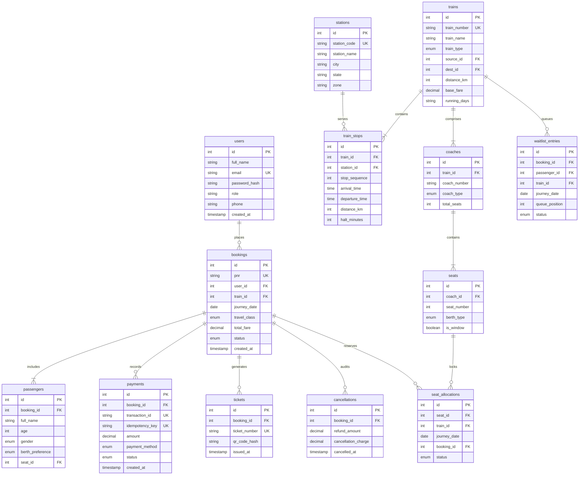

# RailSync — Database Architecture & Data Dictionary

This document specifies the database design, schema definitions, relational integrity constraints, indexes, and concurrency mechanisms implemented in **RailSync**.

---

## 1. Relational Architecture & ER Diagram

The database operates under **MySQL 8.4** using the **InnoDB** storage engine to support multi-version concurrency control (MVCC), foreign key constraints, and ACID transactions.



---

## 2. Table Specifications & Data Dictionary

### 2.1 `users`
Stores registered customer accounts and system administrators.
- `id` (INT, PK, AUTO_INCREMENT): Unique user identifier.
- `full_name` (VARCHAR(100), NOT NULL): Legal passenger name.
- `email` (VARCHAR(100), NOT NULL, UNIQUE): Authentication email.
- `password_hash` (VARCHAR(255), NOT NULL): Scrypt/PBKDF2 salted password hash.
- `role` (ENUM('USER', 'ADMIN'), DEFAULT 'USER'): Role-based access control.
- `phone` (VARCHAR(15), NULL): Contact telephone number.
- `created_at` (TIMESTAMP, DEFAULT CURRENT_TIMESTAMP).

### 2.2 `stations`
Master catalog of 55 railway stations across India.
- `id` (INT, PK, AUTO_INCREMENT): Station identifier.
- `station_code` (VARCHAR(10), NOT NULL, UNIQUE): 3-4 letter standard railway code (e.g. `NDLS`, `CSMT`, `SBC`, `HWH`).
- `station_name` (VARCHAR(100), NOT NULL): Full station title.
- `city` (VARCHAR(100), NOT NULL): Operating metropolitan city.
- `state` (VARCHAR(100), NOT NULL): State / Union Territory.
- `zone` (VARCHAR(50), NOT NULL): Zonal railway administration (e.g. `NR`, `WR`, `CR`, `SR`).

### 2.3 `trains`
Catalog of 48 scheduled train services.
- `id` (INT, PK, AUTO_INCREMENT): Internal train ID.
- `train_number` (VARCHAR(10), NOT NULL, UNIQUE): Official 5-digit train number (e.g. `12004`, `22436`, `12952`).
- `train_name` (VARCHAR(100), NOT NULL): Registered train service name.
- `train_type` (ENUM('VANDE_BHARAT', 'RAJDHANI', 'SHATABDI', 'DURONTO', 'GARIB_RATH', 'SUPERFAST', 'MAIL_EXPRESS', 'INTERCITY', 'EXPRESS')): Category.
- `source_id` (INT, FK -> stations.id): Origin terminal.
- `dest_id` (INT, FK -> stations.id): Destination terminal.
- `distance_km` (INT, NOT NULL): Total corridor distance.
- `base_fare` (DECIMAL(8,2), NOT NULL): Standard sleeper/second seating base fare.
- `running_days` (VARCHAR(50), DEFAULT 'Daily'): Service operating schedule.

### 2.4 `train_stops`
206 timetable stops detailing intermediate journey sequences.
- `id` (INT, PK, AUTO_INCREMENT): Stop record identifier.
- `train_id` (INT, FK -> trains.id, ON DELETE CASCADE): Associated train.
- `station_id` (INT, FK -> stations.id): Intermediate or terminal station.
- `stop_sequence` (INT, NOT NULL): Ordinal sequence along route ($1, 2, 3, \dots$).
- `arrival_time` (TIME, NULL): Arrival timestamp.
- `departure_time` (TIME, NULL): Departure timestamp.
- `distance_km` (INT, NOT NULL): Distance from origin station.
- `halt_minutes` (INT, DEFAULT 2): Scheduled halt duration.
- *Unique Constraint:* `UNIQUE KEY uk_train_stop (train_id, stop_sequence)`.

### 2.5 `coaches` & `seats`
Hardware physical layout mapping.
- `coaches`: 192 coaches linked to trains. Attributes: `coach_number` (e.g. `B1`, `A1`, `H1`), `coach_type` (`1A`, `2A`, `3A`, `CC`, `SL`), and `total_seats` (16 per coach in simulation).
- `seats`: 3,072 seats. Attributes: `seat_number`, `berth_type` (`LOWER`, `MIDDLE`, `UPPER`, `SIDE_LOWER`, `SIDE_UPPER`, `WINDOW`, `AISLE`), and `is_window` boolean.

### 2.6 `bookings`, `passengers`, & `payments`
Core transaction entities.
- `bookings`: Master record storing `pnr` (e.g. `RS57631878`), `journey_date`, `travel_class`, `total_fare`, and `status` (`CONFIRMED`, `CANCELLED`, `WAITLISTED`).
- `passengers`: Passenger manifests storing name, age, gender, berth preference, and mapped `seat_id`.
- `payments`: Financial simulation auditing `transaction_id`, `idempotency_key`, `amount`, and `status` (`PENDING`, `SUCCESS`, `FAILED`).
- `seat_allocations`: Active locks tying a physical `seat_id` to a specific `train_id` and `journey_date`.

---

## 3. Concurrency Control & Row-Level Locking

To guarantee ACID properties and prevent double bookings under high concurrent load:
1. **Pessimistic Seat Locking:**
   ```sql
   SELECT id, status FROM seats 
   WHERE id IN (%s, %s) 
   FOR UPDATE;
   ```
   Executing `FOR UPDATE` acquires exclusive write locks on the targeted seat rows within the active transaction. Competing transactions attempting to reserve the same seats will block until the first transaction commits or rolls back.
2. **Idempotency Verification:**
   ```sql
   SELECT id, booking_id FROM payments 
   WHERE idempotency_key = %s 
   FOR UPDATE;
   ```
   If a client submits repeated payment authorization requests with the same token, the backend detects the duplicate and returns the existing booking confirmation without executing duplicate seat deductions or double charges.
