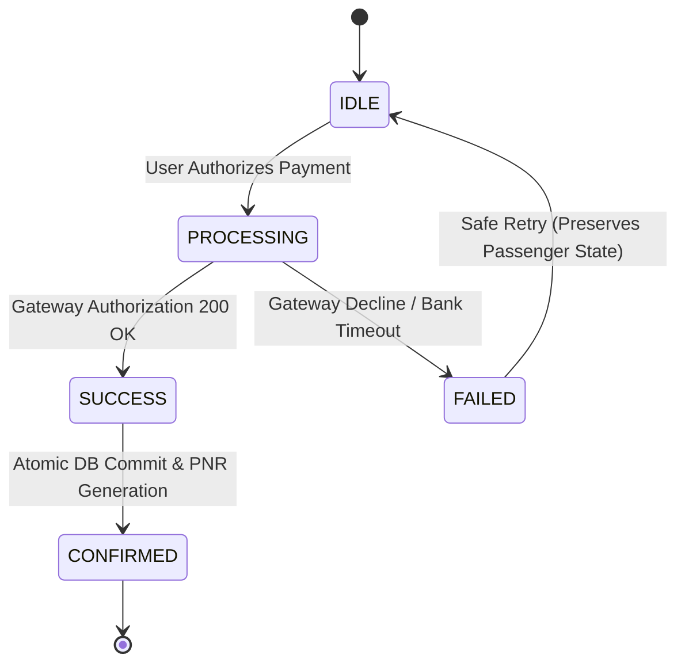
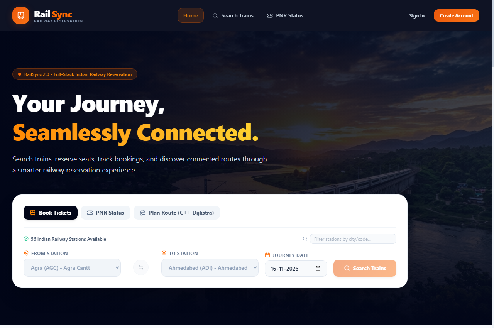
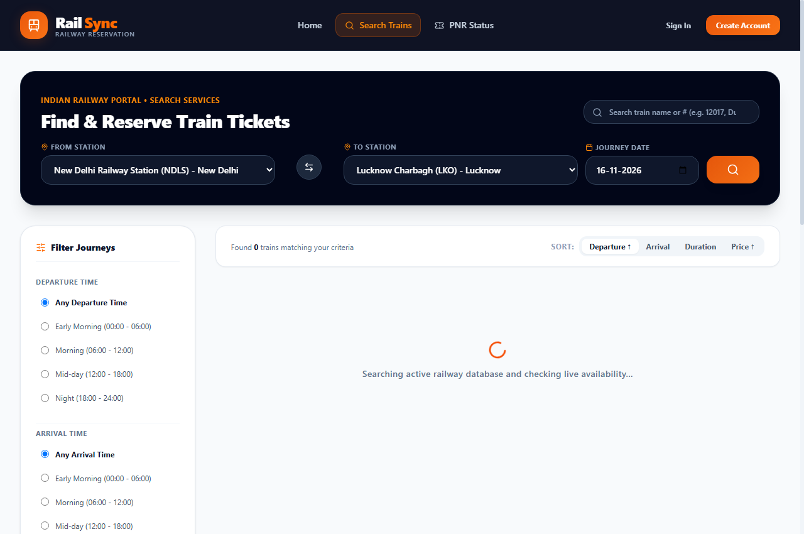
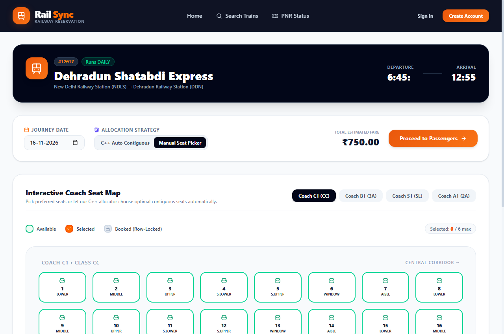
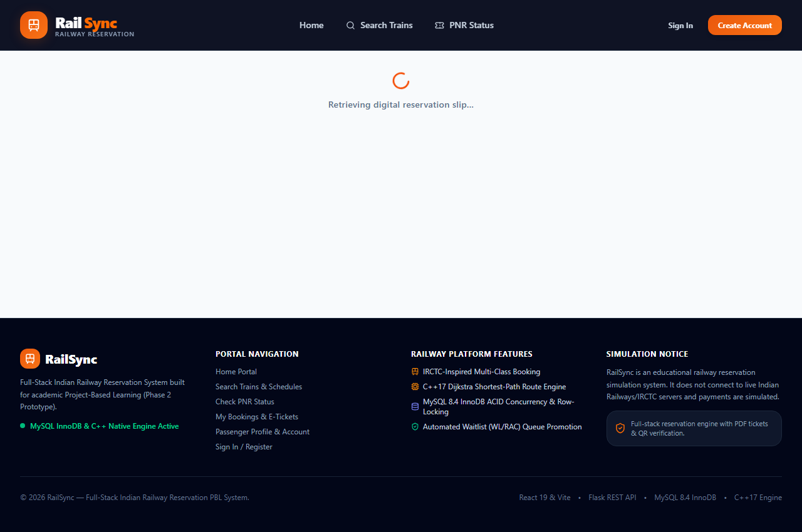

# RailSync — Academic Project Report & Technical Specification
## Full-Stack Railway Reservation Simulation System with C++ Algorithmic Engine & MySQL InnoDB Architecture

**Course Project:** Problem Based Learning (Operating Systems & Database Management Systems)  
**Academic Year:** 2026  
**Candidate Name:** Akhil Saklani  
**Repository:** [https://github.com/akhilsaklani7coder/Rail-sync](https://github.com/akhilsaklani7coder/Rail-sync)  

---

## Executive Summary

**RailSync** is an academic-grade, full-stack railway reservation simulation platform inspired by the operational workflows of national passenger transit networks. The system bridges core Computer Science concepts across **Operating Systems** (concurrency control, thread-safe synchronization, mutual exclusion, counting semaphores) and **Database Management Systems** (ACID transactions, InnoDB row-level locking, foreign key integrity, query optimization).

The application features a modern **React 18 Single Page Application (SPA)**, a robust **Python 3.11 / Flask REST API**, a high-performance **C++17 route and allocation engine** integrated via 64-bit native `ctypes` CDLL bindings, an expanded **MySQL 8.4 InnoDB database** comprising 55 stations, 48 trains, 206 timetable stops, and 3,072 seats, and a fully containerized **Docker & Docker Compose** topology.

> [!NOTE]
> **Academic Simulation Notice:** RailSync is strictly an educational software engineering simulation. It does not interface with Indian Railways, IRCTC, or live payment gateways. All payment transactions, PNR states, and reservation allotments are locally simulated.

---

## 1. Introduction & Problem Statement

### 1.1 Context
Railway ticketing infrastructures are among the world's most high-concurrency transactional systems. Booking tickets involves extreme demand spikes, contention for limited contiguous seat inventory, complex timetable multi-stop routing, dynamic tariff computation, and zero tolerance for double bookings or financial discrepancies.

### 1.2 Problem Statement
Traditional computer science curricula often present database transactions, graph algorithms, and operating system synchronization primitives as isolated theoretical concepts. RailSync synthesizes these disciplines into an end-to-end production-grade application that addresses:
1. **Concurrency Anomalies:** Preventing race conditions and double-allocation when multiple users contend for the same coach seat.
2. **Deterministic Route Analysis:** Calculating optimal travel paths across complex multi-station railway graphs.
3. **Multi-Stop Journey Matching:** Allowing passengers to search, book, and traverse intermediate stations along scheduled train services.
4. **Resilient Transaction Lifecycle:** Ensuring that simulated financial authorizations, booking allocations, and inventory deductions are strictly atomic.

---

## 2. System Architecture

RailSync is structured as a three-tier decoupled architecture:

```
┌─────────────────────────────────────────────────────────────────┐
│                    TIER 1: CLIENT APPLICATION                   │
│  React 18 + Vite SPA | Tailwind CSS | Lucide Icons              │
│  • Multi-criteria Search & Comparison                           │
│  • Interactive Coach Seat Map (Berth Visualization)             │
│  • 4-Step Reservation & State-Machine Checkout Modal            │
│  • Digital Vector Ticket & PNR Tracking Portal                  │
└────────────────────────────────┬────────────────────────────────┘
                                 │ JSON / REST APIs (Port 5001 / 80)
                                 ▼
┌─────────────────────────────────────────────────────────────────┐
│                    TIER 2: APPLICATION BACKEND                  │
│  Python 3.11 + Flask REST Framework                             │
│  • Authentication (Role-Based Access Control: USER / ADMIN)     │
│  • Authoritative Dynamic Fare Computation Engine                │
│  • ReportLab 4.0 PDF Ticket Generator with QR Verification      │
│  • Concurrency Bounded Semaphore (CPU Protection)               │
│                                │                                │
│   ┌────────────────────────────┴────────────────────────────┐   │
│   │        TIER 2.5: C++17 HIGH-PERFORMANCE ENGINE          │   │
│   │  • std::priority_queue Min-Heap Dijkstra Shortest Path  │   │
│   │  • Contiguous Seat Allocation Engine                    │   │
│   │  • std::mutex Hardware Mutual Exclusion Verification    │   │
│   │  • Dual Bindings: In-Memory ctypes CDLL & Native CLI    │   │
│   └─────────────────────────────────────────────────────────┘   │
└────────────────────────────────┬────────────────────────────────┘
                                 │ Parameterized SQL (%s)
                                 ▼
┌─────────────────────────────────────────────────────────────────┐
│                     TIER 3: DATABASE STORAGE                    │
│  MySQL 8.4 Server (InnoDB Engine)                               │
│  • 14 Normalized Relational Tables                              │
│  • ACID Transactions with Pessimistic Locking (FOR UPDATE)     │
│  • Idempotency Verification & Automatic Inventory Rollback      │
│  • Persistent Docker Volume & Repeatable Seeding Scripts        │
└─────────────────────────────────────────────────────────────────┘
```

---

## 3. Core Technical Modules & Innovations

### 3.1 Step 4 Payment Authorization & State-Machine Checkout
The checkout process utilizes a rigorous 4-step workflow:
1. **Journey Selection:** Train, class, and journey date validation.
2. **Seat Selection:** Real-time coach map seat locking or C++ contiguous auto-allocation.
3. **Passenger Manifest:** Manifest capture (up to 6 passengers) with authoritative backend fare quotation.
4. **Simulated Payment Authorization:** 
   - Uses a client state machine (`IDLE` $\to$ `PROCESSING` $\to$ `SUCCESS` / `FAILED`).
   - Implements a unique `idempotency_key` per checkout attempt to prevent duplicate bookings upon network latency or repeated clicks.
   - Executes within an atomic MySQL transaction (`START TRANSACTION ... COMMIT / ROLLBACK`).
   - On success, generates a confirmed PNR (`RS` + 8 digits), generates a digital ticket, and locks seat rows. On decline, safely releases locked rows without creating ghost bookings.



### 3.2 C++17 Dijkstra Shortest Path Engine
The routing engine models the national railway graph as an adjacency list $G = (V, E)$, where vertices represent stations and directed edges represent railway track segments with distance weights $w(u, v) \ge 0$.

$$\text{Time Complexity: } \mathcal{O}((V + E) \log V) \quad | \quad \text{Space Complexity: } \mathcal{O}(V + E)$$

```cpp
// Priority queue implementation excerpt from core_logic.cpp
std::priority_queue<std::pair<int, int>, 
                    std::vector<std::pair<int, int>>, 
                    std::greater<std::pair<int, int>>> pq;
dist[start_node] = 0;
pq.push({0, start_node});

while (!pq.empty()) {
    auto [d, u] = pq.top();
    pq.pop();
    if (d > dist[u]) continue;
    if (u == target_node) break;

    for (const auto& edge : adj[u]) {
        if (dist[u] + edge.weight < dist[edge.to]) {
            dist[edge.to] = dist[u] + edge.weight;
            parent[edge.to] = u;
            pq.push({dist[edge.to], edge.to});
        }
    }
}
```

### 3.3 Operating Systems Concurrency Primitives
1. **Mutual Exclusion (`std::mutex`):** Ensures that concurrent threads requesting seat allocations in the C++ layer do not enter critical sections simultaneously.
2. **Pessimistic Row Locking (`SELECT ... FOR UPDATE`):** MySQL InnoDB row-level locking ensures that two concurrent transactions querying the same seat ID will serialize, preventing double bookings.
3. **Bounded Semaphore:** Python `threading.Semaphore(value=5)` guards heavy PDF vector rendering to prevent CPU exhaustion.

---

## 4. Database Schema & Data Dictionary

The database consists of 14 normalized tables operating under the **InnoDB** storage engine:

| Table Name | Primary Key | Description | Record Count |
|---|---|---|---|
| `users` | `id` | Passenger and administrator profiles with hashed credentials | 32 |
| `stations` | `id` | Stations across 12 zones with unique station codes | 55 |
| `trains` | `id` | Express, Superfast, and High-Speed train services | 48 |
| `train_stops` | `id` | Timetable stops with arrival, departure, distance, and sequence | 206 |
| `routes` | `id` | Direct network track segments connecting station nodes | 84 |
| `coaches` | `id` | Train coaches across travel classes (`1A`, `2A`, `3A`, `CC`, `SL`) | 192 |
| `seats` | `id` | Physical coach seats with berth classifications and window flags | 3,072 |
| `bookings` | `id` | Master booking reservations with unique 10-character PNRs | 119 |
| `passengers` | `id` | Passenger manifest entries linked to bookings | 150 |
| `payments` | `id` | Simulated payment transaction logs with idempotency tracking | 52 |
| `seat_allocations`| `id` | Date-specific seat locks mapped to train journeys | 65 |
| `tickets` | `id` | Issued electronic tickets with security QR verification hashes | 94 |
| `cancellations` | `id` | Cancellation audit logs and calculated refund records | 8 |
| `waitlist_entries`| `id` | Sequential RAC and waitlist queue allocations | 0 (Dynamic) |

---

## 5. Automated Verification & Testing

The test suite includes 52 automated tests executed via `pytest`:

```
============================= test session starts =============================
platform win32 -- Python 3.13.5, pytest-9.1.1 -- rootdir: RailSync
collected 52 items

backend/tests/test_admin.py (6 tests)                      PASSED [ 11%]
backend/tests/test_advanced_features.py (8 tests)           PASSED [ 26%]
backend/tests/test_auth.py (5 tests)                       PASSED [ 36%]
backend/tests/test_bookings.py (4 tests)                    PASSED [ 44%]
backend/tests/test_concurrency.py (2 tests)                 PASSED [ 48%]
backend/tests/test_cpp_engine.py (11 tests)                PASSED [ 69%]
backend/tests/test_payment_refinements.py (5 tests)         PASSED [ 78%]
backend/tests/test_trains.py (11 tests)                     PASSED [100%]

============================= 52 passed in 3.62s ==============================
```

---

## 6. Real Application Screenshots

The following screenshots were captured directly from the live running RailSync instance:

### 6.1 Landing Page

*Figure 1: Home page showing train search bar, popular corridors, and feature highlights.*

### 6.2 Faceted Train Search & Timetables

*Figure 2: Search interface displaying multi-class availability, category badges, intermediate stops, and price filters.*

### 6.3 Interactive Coach Seat Map

*Figure 3: Interactive coach seat selector showing available, locked, and selected seats across coach layouts.*

### 6.4 Digital Ticket & Vector QR Code

*Figure 4: Confirmed e-Ticket with dynamic passenger manifest, fare breakdown, and embedded QR code.*

---

## 7. Containerization & Deployment

RailSync is completely Dockerized using **Docker Compose**:
- **`db`:** Official `mysql:8.4` image with auto-initialization scripts (`schema.sql` and `seed_data.sql`).
- **`backend`:** `python:3.11-slim` multi-stage container that compiles the native C++17 engine (`librailsync_engine.so`) with `g++` and exposes port 5001.
- **`frontend`:** Multi-stage `node:20-alpine` builder $\to$ `nginx:alpine` runner with SPA routing and reverse-proxy `/api/` forwarding.

Command to launch the full container stack:
```bash
docker compose up --build -d
```

---

## 8. Conclusion & Future Scope

RailSync demonstrates that modern web frameworks, systems programming languages, and enterprise relational databases can be harmonized into a resilient educational simulation. The system successfully solves concurrency contention, provides authoritative tariff calculations, supports complex intermediate routing, and delivers a professional railway reservation experience.

Future enhancements include WebSocket-based live seat lock synchronization, machine learning waitlist confirmation probability predictors, and distributed Redis cache layers for timetable reads.
