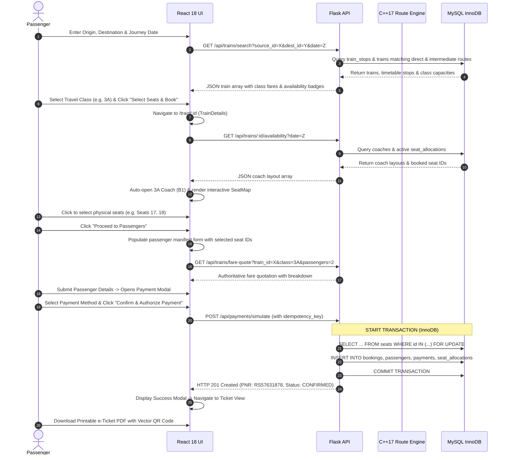
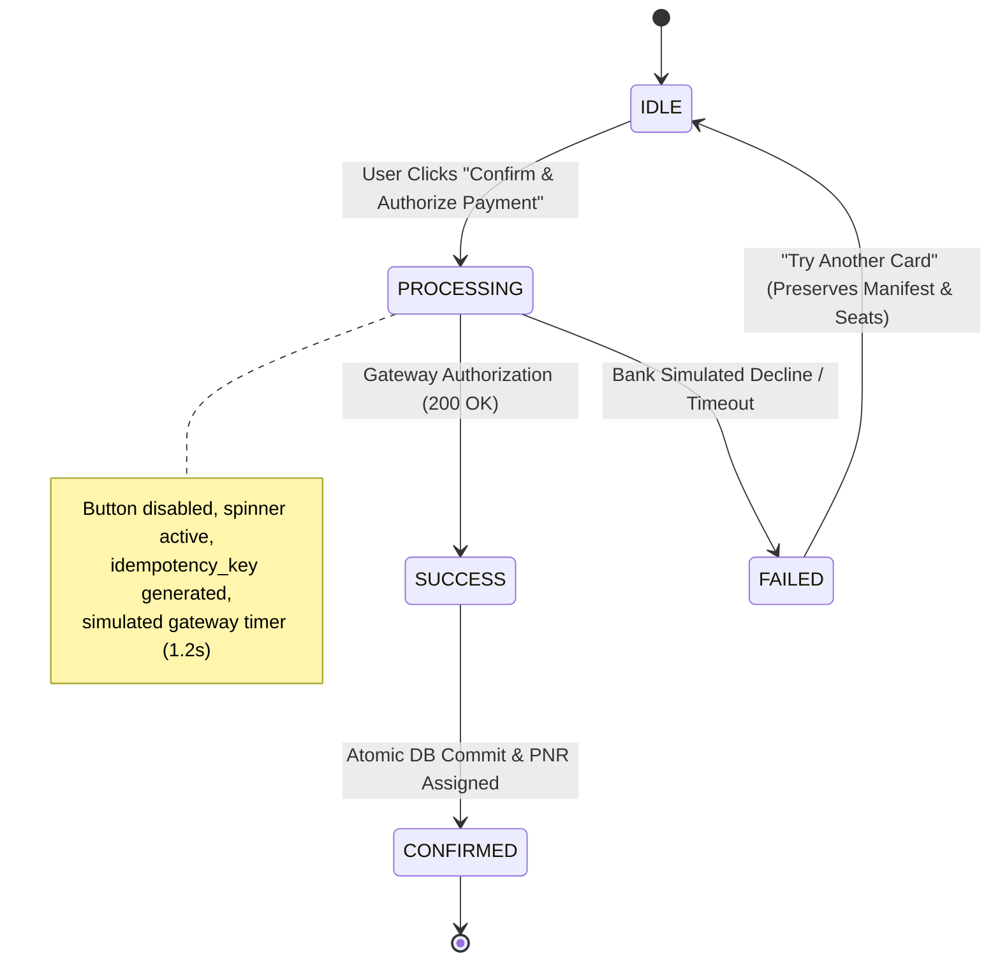

# RailSync — Complete Project Architecture, Workflow & Team Task Specification

**Course Project:** Problem Based Learning (Operating Systems & Database Management Systems)  
**Academic Year:** 2026  
**Repository:** [https://github.com/akhilsaklani7coder/Rail-sync](https://github.com/akhilsaklani7coder/Rail-sync)  
**Live Production Commits:** Synchronized on `main` and `master` branches  

---

## 1. Complete Project Overview

### 1.1 Academic Purpose & Domain Context
**RailSync** is an academic-grade railway reservation simulation platform inspired by the architecture and passenger workflows of national transit networks (such as Indian Railways / IRCTC). Developed as a capstone Project-Based Learning (PBL) system, RailSync bridges fundamental Computer Science principles across two core engineering disciplines:

1. **Operating Systems (OS):**
   - **Mutual Exclusion & Critical Sections:** Native C++17 thread safety implemented using `std::mutex` around shared memory allocators.
   - **Graph Theory & Min-Heap Priority Queues:** Algorithmic shortest-path computation executing in $\mathcal{O}((V + E) \log V)$ time using `std::priority_queue`.
   - **Hardware Resource Throttling:** Counting semaphores (`threading.Semaphore(value=5)`) guarding CPU-intensive vector rendering of PDF e-tickets.
   - **Cross-Platform In-Memory ABI Interoperability:** Direct 64-bit C-ABI integration linking Python memory space to compiled native binaries (`railsync_engine.dll` / `librailsync_engine.so`) via Python `ctypes`.

2. **Database Management Systems (DBMS):**
   - **Relational Normalization:** 14 normalized tables designed in Third Normal Form (3NF) under the MySQL 8.4 InnoDB storage engine.
   - **Strict ACID Transactions:** Multi-statement atomic transactions guaranteeing that booking creation, seat allocation, payment logging, and inventory updates commit atomically or roll back completely.
   - **Pessimistic Concurrency Control:** Row-level locking using `SELECT ... FOR UPDATE` preventing double-booking race conditions during simultaneous passenger demand.
   - **Data Integrity & Constraints:** Composite unique indexes `(train_id, stop_sequence)` and `(coach_id, seat_number)`, cascade deletions, and referential constraints.

> [!IMPORTANT]
> **Academic Simulation Notice:** RailSync is an educational simulation. It does not interface with live IRCTC production servers, banking institutions, or live train dispatchers. All payment processing, PNR records, and ticket generation are executed in local simulation.

---

## 2. Complete System Workflows

### 2.1 End-to-End User Reservation Workflow



---

### 2.2 Step 4 Payment State Machine & Idempotency Protocol
The simulated payment authorization sequence implements a finite state machine:



- **Idempotency Token Protection:** Every checkout attempt attaches a unique UUID token (`idempotency_key`). If network latency causes duplicate clicks or resubmission, the backend detects the existing token and returns the confirmed reservation without executing duplicate charges or duplicate seat locks.
- **Atomic Rollback:** If the simulated gateway triggers a decline, the active MySQL transaction is rolled back (`ROLLBACK`). No seats are locked, and no ghost bookings are created.

---

### 2.3 C++ Dijkstra Shortest Path Engine Workflow
When passengers view train corridors or when administrators analyze route efficiency:
1. Station nodes and railway track edges are extracted from MySQL `routes` and `stations`.
2. Normalized 0-indexed arrays are transferred across the in-memory C-ABI bridge via Python `ctypes`.
3. The C++17 engine constructs an adjacency list and runs Dijkstra's algorithm using a binary min-heap (`std::priority_queue<std::pair<int, int>, ...>`).
4. Traversal executes in $\mathcal{O}((V + E) \log V)$ time, returning the exact node sequence and total track distance in kilometers.

---

### 2.4 Cancellation, Refund & Automatic Waitlist/RAC Promotion Workflow
When a passenger cancels a confirmed ticket:
1. **Cancellation Charge Calculation:** Statutory clerkage fee and time-based cancellation charges are calculated by `backend/app/services/fare_service.py`.
2. **Atomic Seat Release:** The passenger's `seat_allocations` record is deleted within a transaction.
3. **Automatic Waitlist FIFO Promotion:**
   - The system checks `waitlist_entries` for the same train, travel class, and journey date.
   - If an RAC passenger is queued, they are immediately promoted to **CONFIRMED** and assigned the vacated seat.
   - If a Waiting List (WL) passenger is queued, they are promoted to **RAC**.
   - All promotions commit atomically within the cancellation transaction.

---

## 3. Complete Technology Stack

```
┌─────────────────────────────────────────────────────────────────────────────┐
│                           FULL-STACK TECHNOLOGY MATRIX                      │
├──────────────────────┬──────────────────────────────────────────────────────┤
│ Frontend Tier        │ React 18, Vite 8, Tailwind CSS, React Router v7,     │
│                      │ Axios, Lucide React Icons                            │
├──────────────────────┼──────────────────────────────────────────────────────┤
│ Backend API Tier     │ Python 3.11, Flask 3.0, Flask-CORS, Werkzeug 3.1,    │
│                      │ ReportLab 4.0 (PDF Engine), QRCode, Pillow           │
├──────────────────────┼──────────────────────────────────────────────────────┤
│ Systems & Algorithmic│ Native C++17, GCC/MinGW-w64, std::priority_queue,     │
│ Engine               │ std::mutex, ctypes CDLL 64-bit In-Memory ABI         │
├──────────────────────┼──────────────────────────────────────────────────────┤
│ Database Tier        │ MySQL 8.4 Server, InnoDB Engine, Pessimistic Locking │
│                      │ (SELECT ... FOR UPDATE), 14 Normalized 3NF Tables    │
├──────────────────────┼──────────────────────────────────────────────────────┤
│ Containerization     │ Docker Engine 24+, Docker Compose 2.20+, Multi-Stage │
│ & DevOps             │ Alpine Nginx Web Server, Health Checks, Volumes      │
└──────────────────────┴──────────────────────────────────────────────────────┘
```

---

## 4. Team Roles, Task Distribution & Module Ownership

The project responsibilities are distributed among six team members:

```
┌──────────────────────────────────────────────────────────────────────────────────────────────────┐
│                                     TEAM ORGANIZATION MATRIX                                     │
│                                                                                                  │
│   ┌──────────────────────────────────────────────────────────────────────────────────────────┐   │
│   │                                UMANGA (Team Leader)                                      │   │
│   │                         DevOps Architect & System Orchestration                          │   │
│   └──────────────────────────────────────────────────────────────────────────────────────────┘   │
│                                              │                                                   │
│         ┌────────────────────────────────────┼────────────────────────────────────┐              │
│         ▼                                    ▼                                    ▼              │
│  ┌──────────────┐                     ┌──────────────┐                     ┌──────────────┐      │
│  │    AKHIL     │                     │   VEDANSH    │                     │    ADITYA    │      │
│  │ Core Backend │                     │Frontend Lead │                     │Database Arch │      │
│  │  Flask REST  │                     │React 18 SPA  │                     │MySQL InnoDB  │      │
│  └──────────────┘                     └──────────────┘                     └──────────────┘      │
│         │                                                                         │              │
│         └────────────────────────────────────┬────────────────────────────────────┘              │
│                                              │                                                   │
│                        ┌─────────────────────┴─────────────────────┐                             │
│                        ▼                                           ▼                             │
│                 ┌──────────────┐                            ┌──────────────┐                     │
│                 │     YASH     │                            │   ABHINAV    │                     │
│                 │ C++17 Engine │                            │Security/QA/  │                     │
│                 │OS Sync/Dijk  │                            │ Diagnostics  │                     │
│                 └──────────────┘                            └──────────────┘                     │
└──────────────────────────────────────────────────────────────────────────────────────────────────┘
```

---

### Member 1: Umanga (Team Leader & DevOps Architect)

#### Primary Role
Project Leader, Containerization Engineer & System Orchestration Specialist.

#### Modules & Source Files Worked On
- `docker-compose.yml`: Multi-container topology orchestrating MySQL 8.4, Flask backend, and Nginx frontend.
- `frontend/Dockerfile`: Multi-stage production build (`node:20-alpine` builder $\to$ `nginx:alpine` runner).
- `frontend/nginx.conf`: Nginx server block with Single Page Application (SPA) routing and reverse proxy `/api/` directives.
- `backend/Dockerfile`: Debian-based Python 3.11 container compiling C++17 `librailsync_engine.so` via `g++`.
- `DOCKER_GUIDE.md`: Container operations, persistent volume lifecycle, and deployment documentation.

#### Core Technical Contributions
1. **Container Topology:** Designed an isolated Docker network (`railsync-network`) and health checks with startup dependencies (`condition: service_healthy`).
2. **Reverse Proxy Architecture:** Unified the frontend and backend under port 8080 using Nginx, eliminating browser cross-origin preflight overhead.
3. **Volume Lifecycle:** Configured persistent storage (`mysql_data`) ensuring database state survives container restarts.
4. **Milestone Governance:** Led sprint deadlines, Git repository governance, and academic submission alignment.

#### Viva / Defense Topics
- **Question:** *Why use a multi-stage Dockerfile for the frontend instead of running Vite dev server in production?*  
  **Answer:** Multi-stage builds compile static assets with Node.js and discard Node's heavy runtime, serving the minified bundles from an Alpine Nginx image (~30MB vs 600MB+), dramatically reducing attack surface and memory usage.
- **Question:** *How does Docker Compose ensure the Flask backend doesn't crash on startup before MySQL is ready?*  
  **Answer:** Through container health checks (`mysqladmin ping`) and explicit `depends_on: db: condition: service_healthy`, preventing race conditions during container spin-up.

---

### Member 2: Akhil (Core Backend Architect & Flask REST API Engineer)

#### Primary Role
Backend Application Architect, Payment State Machine & Transactional Services Engineer.

#### Modules & Source Files Worked On
- `backend/app/routes/bookings.py` & `backend/app/services/booking_service.py`: Booking creation, PNR lookup, and cancellation controllers.
- `backend/app/routes/payments.py`: Simulated payment gateway API supporting idempotency tokens, bank decline toggles, and state transitions.
- `backend/app/services/fare_service.py`: Rules-based authoritative tariff engine (base fare, class multipliers, surcharges, GST).
- `backend/app/services/waitlist_service.py`: RAC / Waiting list automatic promotion FIFO queue.
- `backend/app/services/pdf_service.py`: ReportLab e-Ticket generator with counting semaphore `threading.Semaphore(value=5)`.
- `backend/app/services/train_service.py` & `backend/app/routes/trains.py`: Train search engine and intermediate stop route matching.

#### Core Technical Contributions
1. **Payment Authorization Architecture:** Overhauled Step 4 payment authorization, introducing idempotency tokens, error-recovery cards, and zero-ghost-booking guarantees.
2. **Backend-Authoritative Fare Quoting:** Implemented dynamic fare computation factoring journey kilometers, travel class multipliers (`1A`, `2A`, `3A`, `CC`, `SL`), superfast surcharges, and statutory GST.
3. **CPU Throttling via OS Semaphore:** Implemented `threading.Semaphore(value=5)` protecting backend memory from CPU spikes during concurrent vector PDF renderings.
4. **Atomic Booking Lifecycle:** Structured reservation transactions so seat locking, booking records, passenger manifests, and payments commit atomically.

#### Viva / Defense Topics
- **Question:** *What problem does the idempotency key solve in the payment workflow?*  
  **Answer:** It prevents double-charging and duplicate reservations if a user double-clicks or experiences network latency; the backend recognizes the duplicate key and returns the existing confirmed booking.
- **Question:** *How does the fare service prevent client-side price tampering?*  
  **Answer:** The frontend sends only train ID, class, and passenger count; the backend recalculates authoritative fares directly from database timetable distances and class coefficients.

---

### Member 3: Vedansh (Frontend Architect & UI/UX Specialist — Swapped)

#### Primary Role
React 18 Single Page Application Developer, Component Architect & UI/UX Specialist.

#### Modules & Source Files Worked On
- `frontend/src/App.jsx` & `frontend/src/layouts/PublicLayout.jsx`: Application navigation routing and top navigation bar.
- `frontend/src/pages/SearchTrains.jsx` & `frontend/src/components/TrainCard.jsx`: Faceted train search, departure/arrival slot filters, 9 category badges, and 3-train comparison modal.
- `frontend/src/pages/TrainDetails.jsx` & `frontend/src/components/SeatMap.jsx`: Interactive Coach Seat Map showing real-time seat availability, coach switching, and class synchronization.
- `frontend/src/pages/PassengerDetails.jsx`: Multi-passenger dynamic manifest form (up to 6 passengers) with berth preferences and seat mapping.
- `frontend/src/pages/Payment.jsx`: 4-step payment checkout modal with state machine transitions (`IDLE` $\to$ `PROCESSING` $\to$ `SUCCESS`/`FAILED`).
- `frontend/src/pages/PNRStatus.jsx`, `TicketDetails.jsx`, & `BookingConfirmation.jsx`: PNR tracking, printable ticket view, and embedded vector QR code.
- `frontend/src/context/AuthContext.jsx` & `ToastContext.jsx`: Global authentication and notification toast state.

#### Core Technical Contributions
1. **Search-to-Seat Flow Connection:** Fixed the navigation flow so clicking "Select Seats & Book" on search cards routes to `/train/:id`, allowing passengers to choose specific physical seats.
2. **Class-Coach Synchronization:** Enhanced `SeatMap.jsx` so selecting a travel class (`3A`, `2A`, `CC`) automatically opens the matching coach (e.g. Coach `B1`).
3. **Checkout State Machine:** Built the interactive payment UI with visual progress indicators, realistic gateway delays, and state-preserving retry flows.
4. **Responsive Visual System:** Implemented a modern design system using Tailwind CSS, Lucide icons, and responsive layouts across mobile, tablet, and desktop viewports.

#### Viva / Defense Topics
- **Question:** *How does the frontend handle seat selection state across multiple components?*  
  **Answer:** Seat state is maintained in `TrainDetails.jsx`, synchronized with `SeatMap.jsx`, and forwarded via React Router location state to `PassengerDetails.jsx`, where each passenger is mapped to their respective `seat_id`.
- **Question:** *How does the UI prevent multiple submissions when authorizing payment?*  
  **Answer:** The payment button triggers a state transition to `PROCESSING`, disabling the button and showing an animated spinner while tracking an active `idempotency_key`.

---

### Member 4: Aditya (Database Architect & SQL Concurrency Engineer — Swapped)

#### Primary Role
Database Architect, MySQL InnoDB Modeling, ACID Transactions & Concurrency Specialist.

#### Modules & Source Files Worked On
- `database/schema.sql`: Full DDL defining 14 normalized tables operating under the MySQL 8.4 InnoDB engine.
- `database/seed_data.sql`: Repeatable 139 KB SQL dataset seeding 55 stations, 48 trains, 206 timetable stops, 84 routes, 192 coaches, and 3,072 seats.
- `backend/scripts/generate_seed_sql.py`: Automated database export utility dumping live database state into clean SQL.
- `DATABASE_DOCUMENTATION.md`: Schema dictionary, entity relationship diagram (ERD), constraint definitions, and indexing strategies.

#### Core Technical Contributions
1. **3NF Relational Normalization:** Structured the database into 14 tables eliminating insertion, update, and deletion anomalies.
2. **Pessimistic Concurrency Control:** Designed and verified `SELECT ... FOR UPDATE` row-level locks on the `seats` table, serializing simultaneous requests for identical seats.
3. **Dataset Expansion:** Built the 55-station railway catalog across 12 zonal divisions and sequenced 206 intermediate timetable stops.
4. **Indexing & Query Optimization:** Implemented composite indexes `(train_id, stop_sequence)` and `(coach_id, seat_number)` to maintain sub-millisecond query performance.

#### Viva / Defense Topics
- **Question:** *What is the difference between table-level locking and row-level locking in high-concurrency booking systems?*  
  **Answer:** Table-level locking locks the entire `seats` table, causing massive queuing and throughput bottlenecks. Row-level locking in InnoDB (`FOR UPDATE`) locks only the specific requested seat rows, allowing thousands of other seats to be booked concurrently.
- **Question:** *How is database integrity maintained if the server crashes mid-booking?*  
  **Answer:** InnoDB's write-ahead redo logging and strict transaction boundaries ensure uncommitted transactions are rolled back upon restart, preventing partial or inconsistent records.

---

### Member 5: Yash (Systems & Algorithms Engineer — C++17 Core)

#### Primary Role
C++17 Systems Programmer, Graph Algorithm Designer & Operating System Synchronization Specialist.

#### Modules & Source Files Worked On
- `backend/cpp_engine/core_logic.cpp` & `core_logic.h`: Native C++17 implementations of Dijkstra's algorithm and contiguous seat allocator.
- `backend/cpp_engine/engine_cli.cpp`: Standalone native CLI execution bridge.
- `backend/cpp_engine/Makefile`: Cross-platform build script generating `railsync_engine.dll` (Windows) and `librailsync_engine.so` (Linux).
- `backend/app/services/cpp_engine_service.py`: In-memory 64-bit ABI bridge using Python `ctypes.CDLL` with subprocess fallback.
- `backend/scripts/build_cpp.py`: Automated build script compiling C++ source files across platforms.

#### Core Technical Contributions
1. **Graph Routing Algorithm:** Modeled the national railway network as a directed weighted graph and implemented Dijkstra's algorithm using `std::priority_queue` min-heap in $\mathcal{O}((V + E) \log V)$ time.
2. **OS Mutual Exclusion Primitives:** Implemented `std::mutex` around critical sections in native C++ to demonstrate OS synchronization principles.
3. **Contiguous Seat Allocator:** Designed the algorithmic windowing function `allocate_seats` ensuring family bookings receive adjacent seats in the same coach row.
4. **Binary ABI Integration:** Configured Python `ctypes` bindings allowing Flask to invoke native compiled C++ machine code in microseconds with zero IPC latency.

#### Viva / Defense Topics
- **Question:** *Why is a min-heap priority queue used in Dijkstra's algorithm instead of a simple array?*  
  **Answer:** A simple array requires $\mathcal{O}(V)$ time to find the minimum vertex, resulting in $\mathcal{O}(V^2)$ total time. A binary min-heap reduces extract-min operations to $\mathcal{O}(\log V)$, lowering overall complexity to $\mathcal{O}((V + E) \log V)$.
- **Question:** *How does `std::mutex` ensure thread safety in the C++ engine?*  
  **Answer:** It enforces mutual exclusion: only one thread can acquire the lock and enter the critical section to access shared allocator buffers; other threads block until the lock is released.

---

### Member 6: Abhinav (Security, System Diagnostics, QR Cryptography & QA Lead — Expanded)

#### Primary Role
Security Engineer, System Diagnostics Architect, Digital QR Cryptographer & Test Automation Lead.

#### Modules & Source Files Worked On
- `backend/app/routes/admin.py`: Built the live System Diagnostics API (`/api/admin/diagnostics`) inspecting MySQL row counts, active connections, ACID rollback verification, and C++ engine status telemetry.
- `backend/app/services/pdf_service.py`: Vector QR code generation, SHA-256 digital validation hashing, and tamper-detection verification (`/api/tickets/<pnr>/verify`).
- `backend/app/routes/auth.py` & Security Middleware: Role-Based Access Control (`USER` vs `ADMIN`), session hardening, and parameterized SQL enforcement across all database queries (`%s`).
- `backend/tests/`: Designed and executed 52 automated tests across 8 comprehensive test suites:
  - `test_admin.py` (6 tests: fleet management, diagnostics, admin RBAC enforcement)
  - `test_advanced_features.py` (8 tests: fare quotes, intermediate stops, refunds, QR codes)
  - `test_auth.py` (5 tests: password hashing, duplicate email rejection, session security)
  - `test_bookings.py` (4 tests: competing seat reservations, PNR masking, ticket download permissions)
  - `test_concurrency.py` (2 tests: InnoDB ACID rollback, simultaneous row-level locking)
  - `test_cpp_engine.py` (11 tests: Dijkstra shortest path, unreachable nodes, mutex verification)
  - `test_payment_refinements.py` (5 tests: idempotency tokens, gateway decline, keyword searches)
  - `test_trains.py` (11 tests: station APIs, multi-category searches, seat availability maps)
- `PROJECT_REPORT.md` & `FINAL_TEST_REPORT.md`: Comprehensive academic project report and test matrix documentation.

#### Core Technical Contributions
1. **Security & RBAC Enforcement:** Hardened application endpoints with role-based authorization ensuring standard users cannot access administrative APIs or view unmasked passenger records.
2. **Real-Time System Diagnostics:** Implemented the diagnostic telemetry endpoint (`/api/admin/diagnostics`) allowing administrators to monitor database health, row allocations, and C++ engine status live.
3. **Digital Ticket Cryptography:** Integrated dynamic vector QR codes containing digital booking hashes, enabling offline authenticity verification.
4. **Automated Stress Testing:** Built multithreaded simulation fixtures in Pytest verifying that competing requests for the same seat commit atomically without double allocations.

#### Viva / Defense Topics
- **Question:** *How was concurrency tested in the automated test suite?*  
  **Answer:** `test_concurrency.py` and `test_bookings.py` simulate two concurrent database sessions competing for the exact same seat ID; the test verifies that the first transaction succeeds with HTTP 201, while the second receives an immediate HTTP 409 Conflict.
- **Question:** *What security measures protect customer passwords and ticket authenticity?*  
  **Answer:** Passwords are salted and hashed using PBKDF2/Scrypt algorithms via Werkzeug (never stored in plaintext), SQL queries strictly use parameterized `%s` bindings to prevent SQL injection, and tickets contain cryptographic QR hashes verified against database records.

---

## 5. Summary Matrix for Evaluation

| Member | Focus Area | Primary Deliverables | Key Viva Topic |
|---|---|---|---|
| **Umanga** *(Leader)* | DevOps & Systems | Docker Compose, Nginx Reverse Proxy, Container Health | Multi-stage Docker builds & Nginx routing |
| **Akhil** | Core Backend | Flask REST API, Payment State Machine, Fares, Waitlist | Idempotency tokens & ACID booking rollback |
| **Vedansh** | Frontend Lead | React 18 SPA, SeatMap Picker, Checkout UI, PNR Inquiry | Component state & class-coach synchronization |
| **Aditya** | Database Architect | MySQL 8.4 InnoDB, 14 Tables, Row Locks (`FOR UPDATE`) | Concurrency control & row vs table locks |
| **Yash** | Systems & Algorithms | C++17 Dijkstra Engine, Min-Heap, `std::mutex`, ctypes | $\mathcal{O}((V+E)\log V)$ complexity & mutual exclusion |
| **Abhinav** | Security & QA | RBAC Security, Diagnostics API, QR Crypto, 52 Tests | Concurrency stress testing & security hardening |
