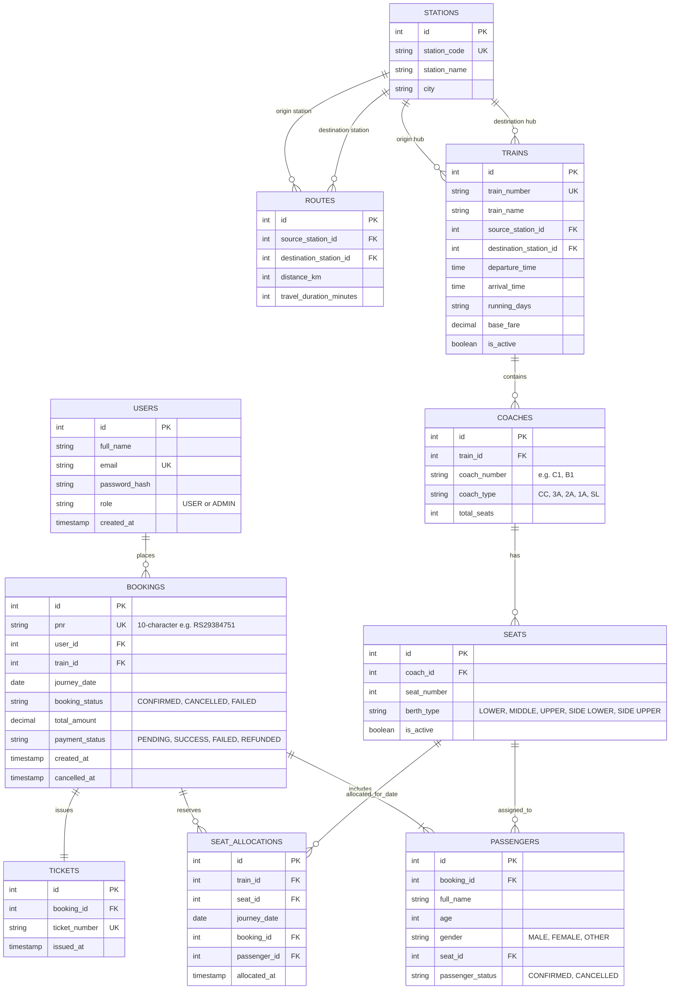

# RailSync Entity-Relationship (ER) Diagram

## Conceptual Model & Normalization
The RailSync database schema is designed according to Third Normal Form (3NF) principles using the MySQL 8 InnoDB storage engine.

### Key Architectural Strengths:
1. **Date-Specific Relational Allocation Model**: Unlike simplistic designs that globally set a `seat.status` column to "BOOKED", RailSync separates physical seat inventory from date-specific reservations via the `seat_allocations` table with a composite `UNIQUE (seat_id, journey_date)` constraint.
2. **Referential Integrity**: Cascading and restrictive foreign key constraints prevent orphaned records.
3. **Optimized Indexes**: B-tree indexes are applied to search paths (`source_station_id`, `destination_station_id`, `is_active`), PNR lookups, and user booking history.

---

## Mermaid ER Diagram

---

## Schema Integrity Rules
* `UNIQUE (email)` on `users` table prevents duplicate customer registration.
* `UNIQUE (seat_id, journey_date)` on `seat_allocations` strictly enforces single-occupancy per journey in MySQL InnoDB.
* `UNIQUE (pnr)` on `bookings` ensures ticket traceability.
* Composite B-Tree index on `(source_station_id, destination_station_id, is_active)` speeds up search queries by index range scan.
