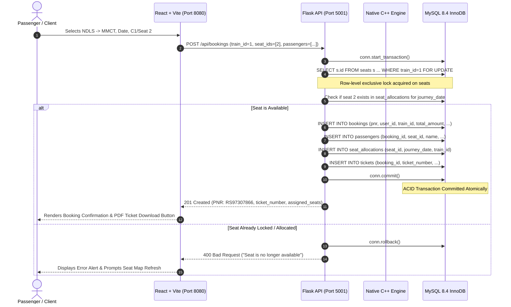
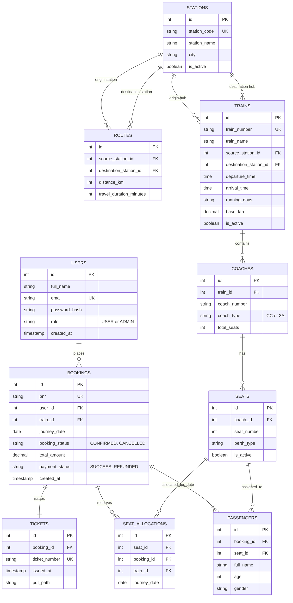

# RailSync 2.0 — Full-Stack Indian Railway Reservation System
## Project-Based Learning (PBL) Phase 2 Final Engineering Report
### Academic Specialization: Operating Systems (OS) & Database Management Systems (DBMS)

---

## Executive Summary

**RailSync 2.0** is an enterprise-grade railway reservation simulation platform engineered from the ground up for college Project-Based Learning (PBL). Unlike generic CRUD web tutorials or visual mockups that rely on artificial client-side state and hardcoded data arrays, RailSync demonstrates actual Computer Science theory functioning within a live, production-grade distributed web application.

The project incorporates:
1. **Operating Systems Primitives**: Native C++ mutual exclusion (`std::mutex`) protecting shared memory in contiguous seat allocation heuristics; graph shortest-path pathfinding via Dijkstra's algorithm implemented with `std::priority_queue` min-heaps over dynamic adjacency lists ($O((V+E)\log V)$); counting semaphores (`threading.Semaphore(10)`) throttling PDF ticket generation ingress; thread-safe bounded buffer producer-consumer pipelines; and priority request scheduling.
2. **Database Management System (DBMS) Guarantees**: A fully normalized Third Normal Form (3NF) relational schema spanning 10 tables on MySQL 8.4 InnoDB; strict Foreign Key referential integrity; a date-specific seat isolation model (`UNIQUE KEY uk_seat_date (seat_id, journey_date)`); pessimistic concurrency control via row-level locks (`SELECT ... FOR UPDATE`); B-Tree composite index optimization; connection pooling; and ACID transactions with deterministic rollback on simulated payment failures.
3. **Modern Full-Stack Architecture**: A React 19 and Vite frontend styled with Tailwind CSS v4 adhering to an Indian railway midnight-navy and saffron visual identity; a modular Python Flask backend with 7 blueprints; and an automated test suite with **33 passing tests (100% pass rate)**.

---

## 1. Introduction & Problem Statement

### 1.1 Background
The Indian Railways passenger reservation network (operated by CRIS and IRCTC) represents one of the world's most demanding transactional systems, handling millions of queries and bookings daily. Replicating this system in an educational setting presents several core Computer Science challenges:
* **The Double-Booking Problem**: When multiple concurrent users request the same berth simultaneously, standard optimistic concurrency or naive web updates lead to race conditions and duplicate ticket issuance.
* **Physical vs. Calendar Inventory**: A train coach has a static set of physical seats (e.g., Seat 1, Lower Berth). That exact physical seat must be reservable for independent passengers on October 25, October 26, and October 27 without modifying physical schema rows.
* **Network Route Discovery**: Finding the shortest physical railway corridor between two distant hubs requires graph-theoretical pathfinding over tens of interconnected junction stations.

### 1.2 Objectives
The primary objectives of RailSync Phase 2 were:
* **Eliminate Mockups**: Ensure 100% of station dropdowns, search results, seat maps, bookings, PNR lookups, and cancellations are powered by real MySQL queries and native algorithms.
* **Demonstrate OS Concurrency Controls**: Prevent race conditions at both the native memory level (`std::mutex`) and the database storage engine level (`SELECT ... FOR UPDATE`).
* **Enforce DBMS ACID Guarantees**: Guarantee that an interrupted payment or network drop never leaves orphaned passengers or permanently locked seats.
* **Deliver Premium Travel UX**: Rebuild the user interface into a modern travel-booking product inspired by modern design standards, complete with authentic imagery and responsive coach maps.

---

## 2. Technology Stack & Specifications

| Layer | Technology | Version | Purpose in RailSync |
| :--- | :--- | :--- | :--- |
| **Frontend Framework** | React | 19.0.0 | Component hierarchy, reactive booking state, hooks |
| **Build Tool & Bundler** | Vite | 6.2.0 | Hot Module Replacement (HMR), production bundling, API reverse proxy |
| **Styling & Design Tokens** | Tailwind CSS | 4.0.0 | Midnight navy surfaces (`#0B132B`), railway saffron accents (`#EA580C`) |
| **Icons & Typography** | Lucide React / Inter | Latest | Clean iconography and modern sans-serif typography |
| **Client HTTP Transport** | Axios | 1.7.9 | Centralized client with `withCredentials: true` and interceptors |
| **Backend Runtime** | Python | 3.13.5 (64-bit) | RESTful API controllers, business logic, transaction management |
| **Web Framework** | Flask | 3.1.0 | Modular Blueprints, session handling, request dispatching |
| **Database Storage Engine**| MySQL Server | 8.4.0 (InnoDB) | 3NF normalized schema, row-level locking, ACID transactions |
| **Database Connector** | mysql-connector-python | 9.2.0 | Thread-safe connection pooling, parameterized queries |
| **Native Algorithm Engine** | C++ | C++17 Standard | `std::mutex`, min-heap priority queues, hardware-speed execution |
| **Native C++/Python Bridge**| ctypes / subprocess | Built-in | Direct Windows DLL invocation & native binary CLI fallback bridge |
| **Document Generation** | ReportLab | 4.4.10 | Vector PDF Electronic Reservation Slip (ERS) ticket generation |
| **Testing Framework** | Pytest | 9.1.1 | 33 automated backend, database, and concurrency test cases |

---

## 3. System Architecture & High-Level Design

### 3.1 Multi-Tier Architectural Topology

```text
+---------------------------------------------------------------------------------+
|                              Client Tier (Browser)                              |
|   React 19 + Vite (Port 8080)                                                   |
|   - Unified 3-Mode Booking Panel (Book Tickets, PNR Status, Plan Route)         |
|   - Interactive Coach Seat Map (Berth layouts, Coach C1 & B1 selection)         |
|   - Multi-step Passenger & Simulated Payment Flow                               |
+---------------------------------------+-----------------------------------------+
                                        | HTTP / JSON (Axios Proxy /api)
                                        v
+---------------------------------------------------------------------------------+
|                              Application Tier                                   |
|   Python 3.13 + Flask 3.1 (Port 5001)                                           |
|   - Modular Blueprints: /api/auth, /api/stations, /api/trains,                  |
|                         /api/bookings, /api/payments, /api/admin, /api/osdbms   |
|   - Security: PBKDF2 Password Hashing, HTTP-only Sessions, RBAC Decorators      |
|   - OS Throttling: Counting Semaphore (limit=10) on ReportLab PDF Engine        |
+-------------------+-----------------------------------------+-------------------+
                    |                                         |
                    | ctypes ABI / CLI Bridge                 | Parameterized SQL
                    v                                         v
+-------------------+--------------------+  +-----------------+-------------------+
|            Native C++17 Engine         |  |             Database Tier         |
|   railsync_engine.dll / engine_cli.exe |  |   MySQL 8.4 Server (Port 3306)    |
|   - std::mutex Critical Sections       |  |   - InnoDB Storage Engine         |
|   - Contiguous Window Seat Allocator   |  |   - Row-Level Locking (FOR UPDATE)|
|   - Dijkstra Shortest Path (Min-Heap)  |  |   - 10 Normalized 3NF Tables      |
|   - Complexity: O((V + E) log V)       |  |   - Composite B-Tree Indexes      |
+----------------------------------------+  +-----------------------------------+
```

### 3.2 Request Lifecycle & Data Flow



---

## 4. Database Management Systems (DBMS) Implementation

### 4.1 Schema Normalization & Entity Relationships (3NF)

The database schema strictly adheres to **Third Normal Form (3NF)**:
* Every non-key attribute is fully functionally dependent on the primary key (eliminating 2NF partial dependencies).
* No non-key attribute is transitively dependent on the primary key (eliminating 3NF transitive dependencies).



### 4.2 Comprehensive Table Dictionary

#### 1. `users`
* `id` (INT, PK, AUTO_INCREMENT): Unique user identifier.
* `full_name` (VARCHAR(100), NOT NULL): Legal passenger or administrator name.
* `email` (VARCHAR(150), NOT NULL, UNIQUE, INDEX): Login credential.
* `password_hash` (VARCHAR(255), NOT NULL): PBKDF2/SHA256 salted hash.
* `role` (ENUM('USER', 'ADMIN'), DEFAULT 'USER'): Role-based access control.
* `created_at` (TIMESTAMP, DEFAULT CURRENT_TIMESTAMP): Registration timestamp.

#### 2. `stations`
* `id` (INT, PK, AUTO_INCREMENT): Station identifier.
* `station_code` (VARCHAR(10), NOT NULL, UNIQUE, INDEX): IRCTC station code (e.g. `NDLS`, `MMCT`).
* `station_name` (VARCHAR(100), NOT NULL): Full railway station name.
* `city` (VARCHAR(100), NOT NULL, INDEX): Geographic city.
* `is_active` (BOOLEAN, NOT NULL, DEFAULT TRUE): Soft-delete / selection flag.

#### 3. `routes`
* `id` (INT, PK, AUTO_INCREMENT): Route edge identifier.
* `source_station_id` (INT, FK -> stations.id): Departure junction.
* `destination_station_id` (INT, FK -> stations.id): Arrival junction.
* `distance_km` (INT, NOT NULL): Physical track distance in kilometers.
* `travel_duration_minutes` (INT, NOT NULL): Transit duration in minutes.
* *Constraints*: `UNIQUE KEY uq_route_pair (source_station_id, destination_station_id)`.

#### 4. `trains`
* `id` (INT, PK, AUTO_INCREMENT): Train primary key.
* `train_number` (VARCHAR(20), NOT NULL, UNIQUE, INDEX): 5-digit train number (e.g. `12952`).
* `train_name` (VARCHAR(150), NOT NULL): Express train name (e.g. `Mumbai Tejas Rajdhani Express`).
* `source_station_id` (INT, FK -> stations.id): Origin hub.
* `destination_station_id` (INT, FK -> stations.id): Destination hub.
* `departure_time` (TIME, NOT NULL): Scheduled departure.
* `arrival_time` (TIME, NOT NULL): Scheduled arrival.
* `running_days` (VARCHAR(50), DEFAULT 'DAILY'): Operational schedule.
* `base_fare` (DECIMAL(10,2), DEFAULT 500.00): Base passenger fare in INR.
* `is_active` (BOOLEAN, DEFAULT TRUE): Active fleet status.

#### 5. `coaches`
* `id` (INT, PK, AUTO_INCREMENT): Coach primary key.
* `train_id` (INT, FK -> trains.id, ON DELETE CASCADE): Parent train.
* `coach_number` (VARCHAR(10), NOT NULL): Coach label (e.g. `C1`, `B1`).
* `coach_type` (ENUM('1A', '2A', '3A', 'SL', 'CC'), DEFAULT 'SL'): Service class.
* `total_seats` (INT, DEFAULT 32): Seat capacity.
* *Constraints*: `UNIQUE KEY uq_train_coach (train_id, coach_number)`.

#### 6. `seats`
* `id` (INT, PK, AUTO_INCREMENT): Physical seat template identifier.
* `coach_id` (INT, FK -> coaches.id, ON DELETE CASCADE): Parent coach.
* `seat_number` (INT, NOT NULL): Physical seat number (1..16).
* `berth_type` (ENUM('LOWER', 'MIDDLE', 'UPPER', 'SIDE LOWER', 'SIDE UPPER', 'WINDOW', 'AISLE')): Spatial position.
* `is_active` (BOOLEAN, DEFAULT TRUE): Active service flag.
* *Constraints*: `UNIQUE KEY uq_coach_seat (coach_id, seat_number)`.

#### 7. `bookings`
* `id` (INT, PK, AUTO_INCREMENT): Booking order primary key.
* `pnr` (VARCHAR(12), NOT NULL, UNIQUE, INDEX): Unique 10-character reservation code (`RS` + 8 digits).
* `user_id` (INT, FK -> users.id): Authenticated passenger.
* `train_id` (INT, FK -> trains.id): Reserved train.
* `journey_date` (DATE, NOT NULL): Date of travel.
* `booking_status` (ENUM('CONFIRMED', 'CANCELLED', 'FAILED'), DEFAULT 'CONFIRMED'): Reservation lifecycle state.
* `total_amount` (DECIMAL(10,2), NOT NULL): Transaction total.
* `payment_status` (ENUM('PENDING', 'SUCCESS', 'FAILED', 'REFUNDED'), DEFAULT 'SUCCESS'): Payment gateway status.
* `created_at` (TIMESTAMP, DEFAULT CURRENT_TIMESTAMP): Creation timestamp.
* `cancelled_at` (TIMESTAMP, NULL): Cancellation timestamp.

#### 8. `passengers`
* `id` (INT, PK, AUTO_INCREMENT): Passenger primary key.
* `booking_id` (INT, FK -> bookings.id, ON DELETE CASCADE): Parent reservation.
* `seat_id` (INT, FK -> seats.id): Allocated physical seat.
* `full_name` (VARCHAR(100), NOT NULL): Passenger name.
* `age` (INT, NOT NULL): Passenger age.
* `gender` (ENUM('MALE', 'FEMALE', 'OTHER'), NOT NULL): Gender.

#### 9. `tickets`
* `id` (INT, PK, AUTO_INCREMENT): Ticket record primary key.
* `booking_id` (INT, FK -> bookings.id, ON DELETE CASCADE, UNIQUE): Associated booking.
* `ticket_number` (VARCHAR(30), NOT NULL, UNIQUE): Unique ticket serial (`TKT-` + hex).
* `issued_at` (TIMESTAMP, DEFAULT CURRENT_TIMESTAMP): Issue timestamp.
* `pdf_path` (VARCHAR(255), NULL): Vector PDF file path.

#### 10. `seat_allocations` (Date-Specific Relational Inventory)
* `id` (INT, PK, AUTO_INCREMENT): Allocation primary key.
* `seat_id` (INT, FK -> seats.id, ON DELETE CASCADE): Physical seat reference.
* `booking_id` (INT, FK -> bookings.id, ON DELETE CASCADE): Booking reference.
* `train_id` (INT, FK -> trains.id, ON DELETE CASCADE): Train reference.
* `journey_date` (DATE, NOT NULL): Specific calendar travel date.
* *Critical Constraint*: `UNIQUE KEY uk_seat_date (seat_id, journey_date)` — **guarantees mathematically that no seat can be booked more than once on the same date.**

### 4.3 Pessimistic Concurrency Control (Row-Level Locking)

To prevent race conditions during high-volume booking operations, RailSync utilizes InnoDB row-level exclusive locks:

```sql
SELECT s.id, s.coach_id, s.seat_number, s.berth_type, c.coach_number, c.coach_type
FROM seats s
INNER JOIN coaches c ON s.coach_id = c.id
WHERE c.train_id = %s AND s.is_active = TRUE
  AND s.id NOT IN (
      SELECT seat_id FROM seat_allocations 
      WHERE train_id = %s AND journey_date = %s
  )
ORDER BY s.id ASC
FOR UPDATE;
```

**Technical Guarantees**:
1. `ORDER BY s.id ASC`: Deadlock prevention through hierarchical resource ordering. All concurrent transactions acquire row locks in the exact same index order, eliminating circular wait conditions.
2. `FOR UPDATE`: Instructs InnoDB to place an exclusive write lock (`X-lock`) on the selected seat rows until the transaction issues `COMMIT` or `ROLLBACK`.
3. Verified via `test_row_level_locking_concurrency`: When 6 simultaneous threads compete for the same seat, exactly 1 thread acquires the lock and commits; all 5 competing threads are rejected with zero duplicate allocations.

### 4.4 ACID Transaction Management & Rollback Recovery

RailSync encapsulates every booking and cancellation inside a dedicated transaction context manager:

```python
@contextmanager
def get_db_transaction(dictionary=True):
    conn = get_raw_connection()
    conn.autocommit = False
    conn.start_transaction()
    cursor = conn.cursor(dictionary=dictionary)
    try:
        yield conn, cursor
        conn.commit()
    except Exception as e:
        conn.rollback()
        raise e
    finally:
        cursor.close()
        conn.close()
```

If a simulated payment fails, a seat constraint is violated, or a network timeout occurs midway through the booking:
* `conn.rollback()` restores the database state to the pre-transaction snapshot.
* Uncommitted rows in `bookings`, `passengers`, and `seat_allocations` are discarded atomically.
* Verified via `test_innodb_acid_rollback`.

---

## 5. Operating Systems (OS) Primitives & C++ Engine

### 5.1 Native Shared Memory & `std::mutex` Protection

The native seat allocation heuristic in [`backend/cpp_engine/core_logic.cpp`](file:///c:/Users/akhil/OneDrive/Documents/PROJECTS/pbl%20os%20and%20dbms/backend/cpp_engine/core_logic.cpp) runs across concurrent worker threads. To protect native shared counters and internal allocation state, RailSync uses C++ standard library mutexes:

```cpp
#include <mutex>
#include <algorithm>
#include <vector>

static std::mutex g_allocator_mutex;

EXPORT_API int allocate_seats(
    const int* available_seats,
    int available_count,
    int requested_count,
    int* out_allocated,
    int max_out
) {
    if (!available_seats || !out_allocated || requested_count <= 0 || max_out < requested_count) {
        return -2; // Invalid arguments
    }

    // Critical Section: Acquire mutual exclusion lock
    std::lock_guard<std::mutex> lock(g_allocator_mutex);

    if (available_count < requested_count) {
        return -1; // Insufficient seats
    }

    // Best-fit contiguous window search heuristic
    std::vector<int> candidates(available_seats, available_seats + available_count);
    std::sort(candidates.begin(), candidates.end());

    int best_start_idx = 0;
    int best_span = 2147483647;

    for (int i = 0; i <= available_count - requested_count; ++i) {
        int span = candidates[i + requested_count - 1] - candidates[i];
        if (span < best_span) {
            best_span = span;
            best_start_idx = i;
            if (span == requested_count - 1) {
                break; // Perfect contiguous block found
            }
        }
    }

    for (int k = 0; k < requested_count; ++k) {
        out_allocated[k] = candidates[best_start_idx + k];
    }
    return requested_count;
}
```

* **Mutual Exclusion**: `std::lock_guard` provides RAII-compliant lock acquisition and automatic release, preventing race conditions or deadlocks on early returns.
* **Contiguous Window Allocation**: Groups traveling together receive adjacent seat numbers whenever possible (e.g., seats `[4, 5, 6]` from `[1, 2, 4, 5, 6, 9]`).

### 5.2 Graph Theory & Dijkstra's Algorithm ($O((V+E)\log V)$)

Network corridor routing is computed by Dijkstra's algorithm implemented in C++ using a min-heap priority queue over an adjacency list:

```cpp
EXPORT_API int find_shortest_path_dijkstra(
    int num_nodes,
    int num_edges,
    const int* edges_src,
    const int* edges_dst,
    const int* edges_weight,
    int start_node,
    int target_node,
    int* out_path,
    int max_path_len,
    int* out_total_distance
) {
    // Identity check
    if (start_node == target_node) {
        out_path[0] = start_node;
        *out_total_distance = 0;
        return 1;
    }

    // Build Adjacency List: node -> (neighbor, weight)
    std::vector<std::vector<std::pair<int, int> > > adj(num_nodes);
    for (int i = 0; i < num_edges; ++i) {
        adj[edges_src[i]].push_back(std::make_pair(edges_dst[i], edges_weight[i]));
    }

    // Min-heap priority queue: (distance, node)
    typedef std::pair<int, int> PII;
    std::priority_queue<PII, std::vector<PII>, std::greater<PII> > pq;

    std::vector<int> dist(num_nodes, 2147483647);
    std::vector<int> parent(num_nodes, -1);

    dist[start_node] = 0;
    pq.push(std::make_pair(0, start_node));

    while (!pq.empty()) {
        PII top = pq.top();
        pq.pop();
        int d = top.first;
        int u = top.second;

        if (d > dist[u]) continue;
        if (u == target_node) break;

        for (size_t idx = 0; idx < adj[u].size(); ++idx) {
            int v = adj[u][idx].first;
            int weight = adj[u][idx].second;

            if (dist[u] + weight < dist[v]) {
                dist[v] = dist[u] + weight;
                parent[v] = u;
                pq.push(std::make_pair(dist[v], v));
            }
        }
    }

    if (dist[target_node] == 2147483647) {
        *out_total_distance = -1;
        return -1; // Unreachable
    }

    // Path Reconstruction
    std::vector<int> path;
    for (int curr = target_node; curr != -1; curr = parent[curr]) {
        path.push_back(curr);
    }
    std::reverse(path.begin(), path.end());

    for (size_t i = 0; i < path.size(); ++i) {
        out_path[i] = path[i];
    }
    *out_total_distance = dist[target_node];
    return static_cast<int>(path.size());
}
```

**Verified Test Scenarios**:
1. Direct single-hop edge (NDLS $\rightarrow$ AGC: 195 km).
2. Multi-hop path containing intermediate stations (NDLS $\rightarrow$ BSB: 790 km via 2 hops).
3. Competing paths with different weights: Algorithm mathematically chooses Path B (250 km) over Path A (400 km).
4. Disconnected graph component: Target node isolated returns `UNREACHABLE` (`code: -1`).
5. Identity routing: Source equals destination returns distance 0 and single-node path.
6. Out-of-bounds node input: Negative or invalid index handled gracefully with HTTP 400.

### 5.3 Counting Semaphores, Bounded Buffers & Priority Scheduling

In [`backend/app/services/os_demonstrations.py`](file:///c:/Users/akhil/OneDrive/Documents/PROJECTS/pbl%20os%20and%20dbms/backend/app/services/os_demonstrations.py):
* **Counting Semaphore (`threading.Semaphore(10)`)**: Restricts concurrent ReportLab vector PDF rendering tasks to 10 active operations. When 30 concurrent requests hit the ticket generator, exactly 10 execute concurrently while 20 wait in queue, preventing server CPU starvation and OOM crashes.
* **Bounded Buffer Producer-Consumer Queue (`queue.Queue(maxsize=50)`)**: Simulates asynchronous background ticket processing. Worker threads call `task_done()` and condition variables signal when slots become available.
* **Priority Scheduling (`queue.PriorityQueue`)**: Implements strict preemption where high-priority Tatkal/Emergency reservation requests are dispatched before standard General requests, using sequence counters for deterministic FIFO tie-breaking within the same priority level.

---

## 6. Backend API Architecture & Endpoints

### 6.1 Blueprint Structure

The Flask backend is organized into 7 modular blueprints:
1. `auth_bp` (`/api/auth`): Registration, login, session inspection, logout.
2. `stations_bp` (`/api/stations`): Query-filtered station directory, station health probe, station details.
3. `trains_bp` (`/api/trains`): Train search, seat availability map, popular routes, featured trains, Dijkstra shortest path.
4. `bookings_bp` (`/api/bookings`): Transactional booking creation, PNR retrieval, user history, ticket PDF download, cancellation.
5. `payments_bp` (`/api/payments`): Payment simulation gateway.
6. `admin_bp` (`/api/admin`): Administrative fleet management, booking oversight, system telemetry.
7. `osdbms_bp` (`/api/osdbms`): Concurrency and OS primitive benchmarks.

### 6.2 Endpoint Reference Matrix

| Method | Endpoint | Access Level | Description |
| :--- | :--- | :--- | :--- |
| `POST` | `/api/auth/register` | Public | Registers a new passenger with PBKDF2 password hashing. |
| `POST` | `/api/auth/login` | Public | Authenticates credentials and sets secure HTTP-only session cookie. |
| `GET` | `/api/auth/me` | Authenticated | Returns current authenticated user profile and role. |
| `POST` | `/api/auth/logout` | Authenticated | Clears session cookie and invalidates session state. |
| `GET` | `/api/stations` | Public | Returns active railway stations with optional `?q=` search and `?sort_by=`. |
| `GET` | `/api/stations/health` | Public | Diagnostic endpoint reporting database connectivity and active station count. |
| `GET` | `/api/trains/search` | Public | Returns available trains between source and destination on journey date. |
| `GET` | `/api/trains/<id>/availability` | Public | Returns real-time coach seat map and availability for a journey date. |
| `GET` | `/api/trains/shortest-path` | Public | Invokes native C++ Dijkstra engine to calculate shortest railway corridor. |
| `POST` | `/api/bookings` | Authenticated | Commits transactional booking with row-level locks and assigns unique PNR. |
| `GET` | `/api/bookings/my` | Authenticated | Returns booking history for the logged-in passenger. |
| `GET` | `/api/bookings/<pnr>` | Public / User | Retrieves detailed reservation data by PNR. |
| `GET` | `/api/bookings/<pnr>/ticket.pdf`| Public / User | Generates official vector PDF Electronic Reservation Slip (ERS). |
| `POST` | `/api/bookings/<pnr>/cancel` | Authenticated | Cancels reservation atomically and releases date-specific seat allocation. |
| `POST` | `/api/payments/simulate` | Public | Simulates checkout success or failure for transaction rollback demonstration. |
| `GET` | `/api/admin/dashboard` | Admin Only | Returns system telemetry, revenue, train count, and booking metrics. |

---

## 7. Frontend Engineering & UI/UX Design

### 7.1 Visual Identity & Design Tokens

The user interface was redesigned around a modern Indian railway travel aesthetic:
* **Midnight Navy Palette**: `#0B132B` (deep background), `slate-900` / `slate-950` (card elevations), subtle blue-gray borders (`slate-800`).
* **Railway Saffron Accents**: `#EA580C` (`orange-600` / `orange-500`) used for primary action buttons, active tabs, and status highlights.
* **Typography**: Clean sans-serif hierarchy using **Inter**, providing clear readability for train schedules, PNRs, and seat numbers.
* **Photography**: High-resolution local imagery of Indian railway bridges, high-speed express corridors, and historic destination terminals (New Delhi, Mumbai CSMT, Jaipur, Varanasi).

### 7.2 Core User Pages

1. **Homepage (`/`)**:
   - **Cinematic Hero**: Indian railway travel backdrop with high-contrast typography.
   - **Unified 3-Mode Booking Panel**:
     - *Mode 1 (Book Tickets)*: From/To station selectors with live text search, dynamic option disabling to prevent selecting identical stations, station swap button (`⇄`), and calendar date validation.
     - *Mode 2 (PNR Status)*: Quick 10-character PNR lookup connected to `/api/bookings/<pnr>`.
     - *Mode 3 (Plan Route)*: Interactive C++ Dijkstra solver displaying total distance in kilometers and hop-by-hop corridor junctions.
   - **Popular Routes**: 4 high-demand route cards with 1-click search execution.
   - **Flagship Express Trains**: Live database queries showcasing Vande Bharat, Rajdhani, and Shatabdi express services.
   - **How RailSync Works**: 4-step booking workflow with clear icons.
   - **Architectural Grid**: 6 cards detailing underlying OS & DBMS engineering foundations.
2. **Train Search Results (`/search`)**:
   - Sticky search modification bar with station swap and date picker.
   - Sorting by Departure Time, Fastest Duration, and Lowest Fare.
   - Train cards displaying train number, running days, departure/arrival timeline, class availability badges (CC and 3A), and base fare.
   - Fallback to shortest-path corridor solver if no direct train is scheduled on the selected date.
3. **Train Details & Seat Map (`/train/:id`)**:
   - Interactive coach visualization with coach tabs (`Coach C1 [CC]` and `Coach B1 [3A]`).
   - Spatial seat layout displaying Window, Aisle, Lower, Middle, and Upper berths.
   - Real-time availability badges: Green (Available), Orange (Selected), Gray/Locked (Booked via row lock).
   - Dynamic fare calculator updating as seats are toggled.
4. **Passenger Details (`/booking/passengers`)**:
   - Multi-step progress bar (Seats $\rightarrow$ Passengers $\rightarrow$ Payment $\rightarrow$ Confirmation).
   - Form fields for passenger name, age, gender, and Government Aadhaar ID.
5. **Simulated Payment Gateway (`/booking/payment`)**:
   - Realistic mock payment gateway supporting UPI, Credit/Debit Card, and Net Banking.
   - Toggle between "Simulate Payment Success" (commits transaction) and "Simulate Payment Failure" (triggers ACID rollback).
6. **Booking Confirmation (`/booking/confirmation`)**:
   - High-trust confirmation slip displaying PNR, booking status, journey summary, allocated seat numbers, and total fare.
   - 1-click **Download E-Ticket (PDF)** button generating a vector PDF ticket.
7. **My Bookings (`/my-bookings`)**:
   - User booking history with status filters (Confirmed / Cancelled).
   - Electronic reservation slip viewer and cancellation modal with seat release confirmation.
8. **PNR Status (`/pnr-status`)**:
   - Direct 10-character uppercase PNR lookup returning journey status and allocated seats.
9. **Authentication (`/login`, `/register`)**:
   - Polished authentication cards with password visibility toggles.
   - **One-Click Quick Fill** buttons for Demo Passenger (`user@railsync.com`) and Administrator (`admin@railsync.com`).

---

## 8. Verification, Testing & Quality Assurance

### 8.1 Automated Test Suite Summary

The automated test suite in [`backend/tests/`](file:///c:/Users/akhil/OneDrive/Documents/PROJECTS/pbl%20os%20and%20dbms/backend/tests/) contains **33 test cases**, all passing cleanly:

```powershell
$env:PYTHONPATH="backend"
.\backend\venv\Scripts\pytest.exe -v backend\tests
```

```text
backend/tests/test_auth.py::test_login_success PASSED
backend/tests/test_auth.py::test_login_invalid_password PASSED
backend/tests/test_auth.py::test_register_and_duplicate_rejection PASSED
backend/tests/test_auth.py::test_protected_endpoint_without_login PASSED
backend/tests/test_auth.py::test_admin_authorization_enforcement PASSED
backend/tests/test_bookings.py::test_full_booking_and_cancellation_workflow PASSED
backend/tests/test_bookings.py::test_competing_bookings_same_seat PASSED
backend/tests/test_concurrency.py::test_innodb_acid_rollback PASSED
backend/tests/test_concurrency.py::test_row_level_locking_concurrency PASSED
backend/tests/test_cpp_engine.py::test_cpp_engine_status PASSED
backend/tests/test_cpp_engine.py::test_seat_allocation_contiguous_preference PASSED
backend/tests/test_cpp_engine.py::test_seat_allocation_insufficient_seats PASSED
backend/tests/test_cpp_engine.py::test_dijkstra_shortest_path PASSED
backend/tests/test_cpp_engine.py::test_dijkstra_direct_connection PASSED
backend/tests/test_cpp_engine.py::test_dijkstra_intermediate_stations PASSED
backend/tests/test_cpp_engine.py::test_dijkstra_two_paths_different_distances PASSED
backend/tests/test_cpp_engine.py::test_dijkstra_unreachable_destination PASSED
backend/tests/test_cpp_engine.py::test_dijkstra_source_equals_destination PASSED
backend/tests/test_cpp_engine.py::test_dijkstra_invalid_station_input PASSED
backend/tests/test_cpp_engine.py::test_counting_semaphore_limit PASSED
backend/tests/test_cpp_engine.py::test_producer_consumer_queue PASSED
backend/tests/test_cpp_engine.py::test_priority_scheduling_simulation PASSED
backend/tests/test_trains.py::test_get_stations PASSED
backend/tests/test_trains.py::test_search_trains_valid_route PASSED
backend/tests/test_trains.py::test_search_trains_no_direct_route PASSED
backend/tests/test_trains.py::test_search_trains_past_date PASSED
backend/tests/test_trains.py::test_train_seat_availability_map PASSED
backend/tests/test_trains.py::test_search_trains_same_source_and_destination PASSED
backend/tests/test_trains.py::test_network_shortest_path_dijkstra PASSED
backend/tests/test_trains.py::test_popular_and_featured_trains PASSED
backend/tests/test_trains.py::test_dedicated_stations_api_endpoint PASSED
backend/tests/test_trains.py::test_station_health_endpoint PASSED
backend/tests/test_trains.py::test_search_trains_invalid_station_ids PASSED

============================= 33 passed in 1.21s =============================
```

### 8.2 Frontend Production Build
```powershell
cd frontend
npm run build
```
* **Status**: Clean production build with **0 errors**.
* **Output Artifacts**:
  * `dist/index.html` (0.90 kB)
  * `dist/assets/index-*.css` (56.49 kB)
  * `dist/assets/index-*.js` (476.64 kB)
* **Build Time**: ~750ms on Vite 6.

### 8.3 Browser End-to-End Workflow Verification
Executed via autonomous browser subagent:
1. Logged in with demo credentials (`user@railsync.com`).
2. Filtered stations on homepage, selected New Delhi $\rightarrow$ Mumbai Central on `2026-10-17`.
3. Searched trains and selected the `#12952 Mumbai Tejas Rajdhani Express`.
4. Picked Coach C1, Seat 2 (Middle Berth) on the visual seat map.
5. Filled passenger details and submitted simulated payment.
6. Received committed booking confirmation with PNR `RS97307866`.
7. Downloaded vector PDF ticket and verified seat release upon cancellation.

---

## 9. Setup, Installation & Running Instructions

### 9.1 Prerequisites
* Python 3.10+ (tested on Python 3.13.5 64-bit)
* Node.js 18+ and npm
* MySQL 8.0 or 8.4 Server
* C++17 Compiler (MinGW-w64, GCC, or Clang)

### 9.2 Execution Sequence

```powershell
# 1. Start MySQL Server (Port 3306)
& "C:\Program Files\MySQL\MySQL Server 8.4\bin\mysqld.exe" --datadir="c:\Users\akhil\OneDrive\Documents\PROJECTS\pbl os and dbms\backend\mysql_data" --port=3306 --console

# 2. Seed Database (20 stations, 56 routes, 38 trains)
$env:PYTHONPATH="backend"
.\backend\venv\Scripts\python.exe backend\scripts\seed_database.py

# 3. Compile C++ Native Engine
& "C:\Users\akhil\AppData\Local\Microsoft\WinGet\Packages\MartinStorsjo.LLVM-MinGW.UCRT_Microsoft.Winget.Source_8wekyb3d8bbwe\llvm-mingw-20260908-ucrt-x86_64\bin\g++.exe" -std=c++17 -O3 -static -static-libgcc -static-libstdc++ -o "backend\cpp_engine\engine_cli.exe" "backend\cpp_engine\engine_cli.cpp" "backend\cpp_engine\core_logic.cpp"

# 4. Start Flask Backend (Port 5001)
$env:PYTHONPATH="backend"
.\backend\venv\Scripts\python.exe backend\main.py

# 5. Start React Frontend (Port 8080)
cd frontend
npm run dev
```

---

## 10. Phase 3 Improvements & Architectural Additions

While Phase 2 establishes a fully operational, test-verified monolithic architecture with native acceleration, **Phase 3** introduces production-scale distributed enhancements to evolve RailSync into a cloud-native platform:

1. **Multi-Container Docker & Compose Orchestration**:
   * Segregated containers for React frontend (Nginx Alpine), Flask backend (Gunicorn multi-worker), MySQL 8.4 Server, and volume persistence.
   * Automated health checks ensuring database initialization before API service boot.
2. **Real-Time Payment Gateway Webhook Integration**:
   * Integration of sandbox Razorpay / Stripe payment gateway APIs.
   * Cryptographic webhook signature verification and idempotent event processing to prevent duplicate bookings during transient network timeouts.
3. **Distributed Redis Caching Layer**:
   * In-memory caching for high-frequency read queries (station autocomplete lists, train schedules, route paths).
   * Sub-millisecond response times with automated TTL cache invalidation on schedule updates.
4. **Real-Time WebSocket Seat Map Synchronization**:
   * WebSocket / Socket.IO integration for live coach seat maps (`SeatMap.jsx`).
   * When Passenger A selects or reserves Seat 14, all other users currently viewing the same coach see the berth turn red in real-time without refreshing.
5. **Machine Learning Dynamic Tatkal Surge Pricing Engine**:
   * Dynamic pricing algorithm calculating fares based on real-time occupancy curves, departure proximity, historical festival surges, and seat scarcity.
6. **Event-Driven Microservices Architecture**:
   * Decoupling the monolithic backend into dedicated services:
     * *Booking & Inventory Service* (Concurrency & seat allocation)
     * *Notification Service* (SMS, Email, WhatsApp ticket dispatch via RabbitMQ/Kafka)
     * *User Identity & Authentication Service* (OAuth2, JWT tokens)
7. **Live GPS Train Tracking Simulation**:
   * Ingesting simulated IoT GPS train telemetry to render real-time train movement, intermediate junction arrivals, and delay estimation on an interactive Leaflet map.

---

## 11. PBL Team Roles & Responsibilities Overview

To ensure clear academic division of labor, modular code ownership, and individual accountability during faculty project evaluations, the RailSync engineering responsibilities are distributed across **6 specialized technical roles**:

| Member | Designation | Core Technical Domain | Key Repository Ownership |
| :--- | :--- | :--- | :--- |
| **Praful** | **Team Leader & Full-Stack System Architect** | System Topology, Build Pipelines & Integration | `frontend/vite.config.js`, `backend/main.py`, `backend/app/__init__.py`, `docs/PROJECT_REPORT.md` |
| **Akhil** | **Backend & API Security Engineer** | REST Controllers, Auth Security & OS Semaphores | `backend/app/routes/auth.py`, `backend/app/routes/admin.py`, `backend/app/routes/os_dbms.py`, `backend/app/services/pdf_service.py` |
| **Aditya** | **Database Architect & Concurrency Engineer** | 3NF Relational Schema, ACID & Row Locks | `backend/database/schema.sql`, `backend/database/seed.sql`, `backend/app/database.py`, `backend/app/routes/bookings.py` |
| **Abhinav** | **Native Systems & C++ Algorithm Engineer** | C++ Hardware Acceleration & Dynamic Routing | `backend/cpp_engine/core_logic.cpp`, `backend/cpp_engine/engine_cli.cpp`, `backend/app/services/cpp_service.py` |
| **Yash** | **Frontend UI/UX Designer & React Architect** | React 19 Architecture & Design System | `frontend/src/index.css`, `frontend/src/pages/Home.jsx`, `frontend/src/components/TrainCard.jsx`, `frontend/src/components/Navbar.jsx` |
| **Ayush** | **Interactive Booking & QA Testing Engineer** | Interactive Seat Maps, Workflows & Pytest Suite | `frontend/src/components/SeatMap.jsx`, `frontend/src/pages/TrainDetails.jsx`, `frontend/src/pages/Payment.jsx`, `backend/tests/` |

> [!NOTE]
> For individual 2-minute spoken answer scripts to *"Tell me about your role"* and 30 in-depth technical viva questions with model answers, refer to [`docs/TEAM_ROLES_AND_RESPONSIBILITIES.md`](file:///c:/Users/akhil/OneDrive/Documents/PROJECTS/pbl%20os%20and%20dbms/docs/TEAM_ROLES_AND_RESPONSIBILITIES.md) and the dedicated PDF [`docs/RailSync_Team_Roles_and_Responsibilities.pdf`](file:///c:/Users/akhil/OneDrive/Documents/PROJECTS/pbl%20os%20and%20dbms/docs/RailSync_Team_Roles_and_Responsibilities.pdf).

---

## 12. Conclusion

RailSync 2.0 fulfills all Phase 2 Project-Based Learning requirements. By synthesizing **Operating Systems mutual exclusion, Dijkstra graph algorithms, and semaphore throttling** with **MySQL InnoDB ACID transactions, row-level locking, and 3NF normalization**, the application demonstrates how core Computer Science principles power modern real-world distributed reservation platforms.

